# FreeBirdWall

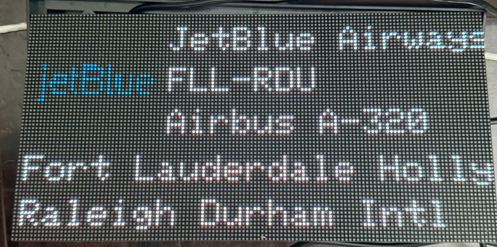

[Website](https://mrsco.github.io/freebirdwall/) · [Install](#install-it) · [Dashboard](#using-the-dashboard) · [Weather & flight card](#weather-and-your-flight-card) · [Analytics](#analytics--stats) · [Games](#play-games-on-the-wall) · [Stats backup](#back-up-your-stats-optional) · [Going back](#going-back) · [Troubleshooting](#if-something-goes-wrong)

**FreeBirdWall** is free firmware for the **FlightWall mini**, the LED panel that shows the planes flying over your home. It
keeps everything the wall already does, needs no subscription, and adds:

- **A dashboard on your phone.** Change every setting from any phone or computer on your Wi-Fi, with a **live preview** of
  the wall as you go, and the areas it watches **on a map**.
- **Progress bars.** Each flight can show how far it is between its airports, along the bottom of the wall.
- **Games on the wall.** Play [Pong and Breakout](#play-games-on-the-wall) on the LEDs, with your phone as the controller. Two phones can play Pong against each other.
- **Free flight data.** Choose the community services ([adsb.fi](https://adsb.fi) and [adsbdb](https://www.adsbdb.com)) instead of the FlightWall service if you like.
- **Your trips on the wall (Sync).** Add your flights or import a calendar file, and the wall shows the trip and follows the plane while it is in the air.
- **Tracked flights**, with real times when you add a FlightAware key.
- **Analytics & Stats** of the planes your wall has seen, computed on the wall itself — a flight-path heat map across all your watch areas, top departure & arrival airports, most common aircraft types, airlines breakdown, rare aircraft badges, an **Explore anywhere** live map, **Share cards** that never show where you live, and optional automatic backups to a computer or NAS on your Wi-Fi — plus **extra clocks** and **your own airport names**.
- **Names that fit.** Long airline and airport names are shortened, and scroll if they are still too long.
- **Weather on the wall.** Live METAR [weather](#weather-and-your-flight-card) when no planes are overhead (Simple,
  Summary or raw METAR), from the station nearest you or one you choose, in your units, on the free flight data too.
  It can also take a turn **between flights**, and so can the clock.
- **A flight card that is yours.** Tap a line on the live preview and [choose what it shows](#weather-and-your-flight-card);
  flight levels, short numbers, the flight number instead of the callsign, up to 30 seconds on each flight.
- **Aircraft silhouettes and current logos.** A drawing of the aircraft when there is no airline logo (by exact
  type when the wall has the pictures), and the wall keeps the maker's logos and icons current from their own signed
  updates.

You can go back to the original firmware at any time: it stays on the wall, next to FreeBirdWall.

---

## What you need

- A FlightWall mini **already set up with the FlightWall app** (so it knows your Wi-Fi).
- A computer with **Google Chrome** or **Microsoft Edge** (Windows, Mac, Linux or ChromeOS).
- A **USB-C data cable**. Some cables only charge; if the computer cannot see the wall, try another cable.
- A small screwdriver to open the back of the wall.
- About 15 minutes.

## Install it

### 1. Open the installer

Open **[https://mrsco.github.io/freebirdwall/install/](https://mrsco.github.io/freebirdwall/install/)** in Chrome or Edge on a computer. Nothing needs
installing, and nothing is sent anywhere: the installer runs in the page and talks to the wall over the USB cable.
(Offline? Save that page, or `freebirdwall-installer.html` from the Releases page, and open the file instead.)

### 2. Plug the wall into your computer

Leave the wall plugged into power. Open the back cover: the small blue controller board sits where the ribbon cable starts.
Plug the USB-C cable into its USB-C port, then into your computer.

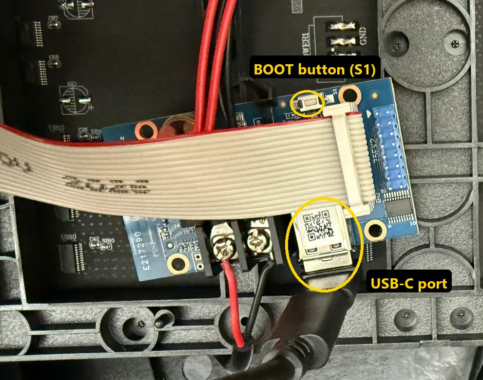

### 3. Run the installer

Follow the installer's steps.

1. **Connect.** Click **Connect** and choose the wall in the list. On Windows it is called *USB Serial Device (COM…)*;
   elsewhere it may be *USB JTAG/serial debug unit*. The panel goes dark while the installer works; that is normal.
2. **Check the board.** The installer reads the chip, its memory and its settings, and only continues if this is exactly the
   board this firmware was made for. If anything is different it stops before changing anything, so the firmware can never land
   on hardware it could damage.

   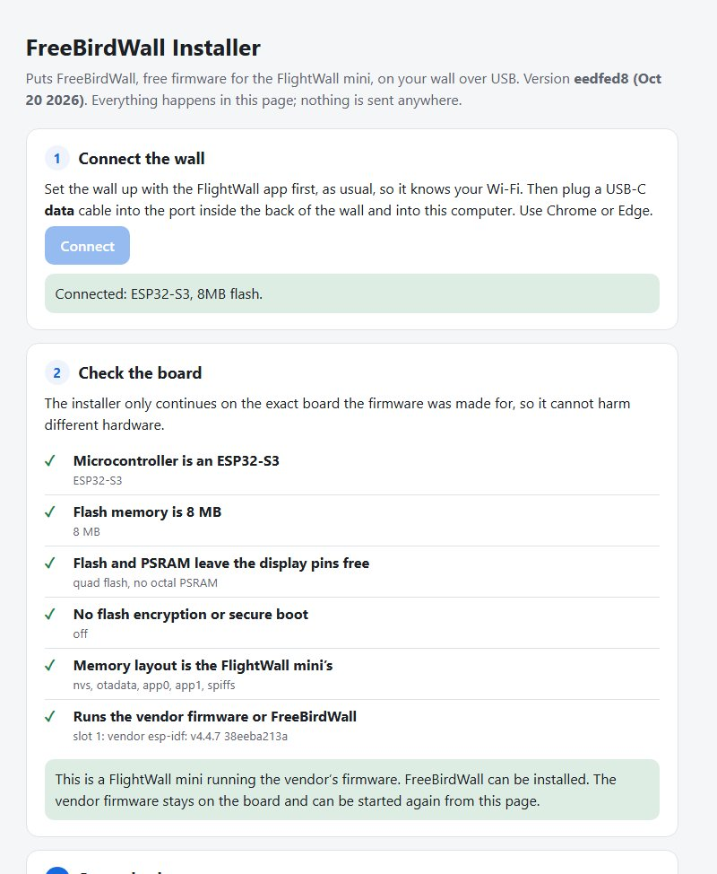

3. **Save a backup.** A complete copy of the wall (8 MB) is saved on your computer and checked; it takes a few minutes. Keep
   it somewhere safe. It is this wall's own copy, including its Wi-Fi password, so do not share it. When you update later and
   still have this backup, **Skip the backup** saves the wait (it asks twice).
4. **Install.** The new firmware is written *next to* the original one, read back to make sure it is right, and only then set to
   start. Your Wi-Fi and settings stay.
5. **First start.** The wall restarts with the new firmware. The installer watches it check the board, join your Wi-Fi, and
   report its address.

   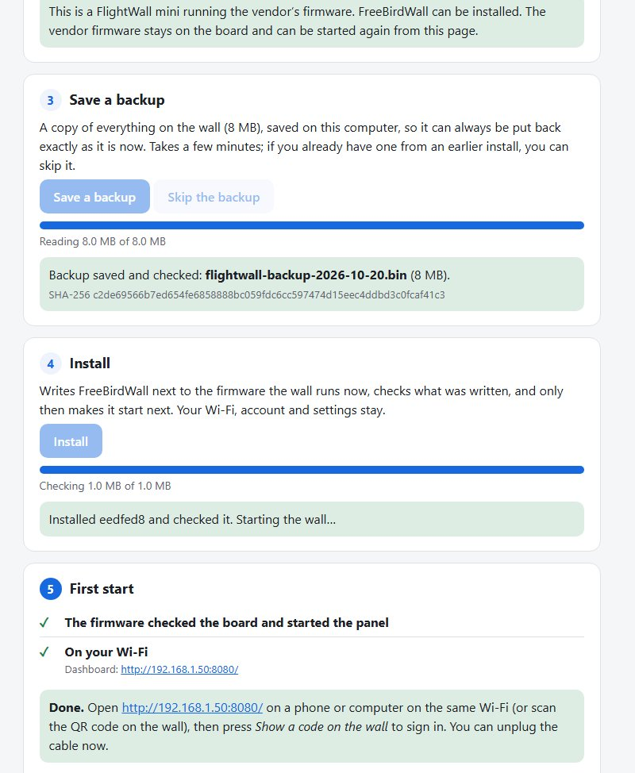

   On the wall, FreeBirdWall says hello while it joins your Wi-Fi:

   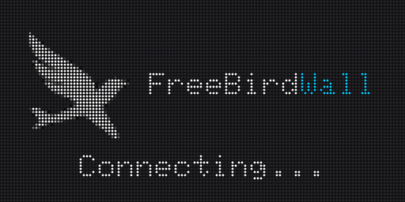

Unplug the USB cable and close the back. You will not need the cable again for everyday use.

### 4. Open your dashboard

For its first minute on Wi-Fi, the wall shows a QR code with its address. Scan it with your phone's camera, or type the
address into a browser on the same Wi-Fi.

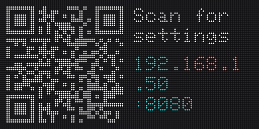

Press **Show a code on the wall**, then type the six digits the wall shows. That phone or computer stays signed in. You can
sign in up to four browsers this way.

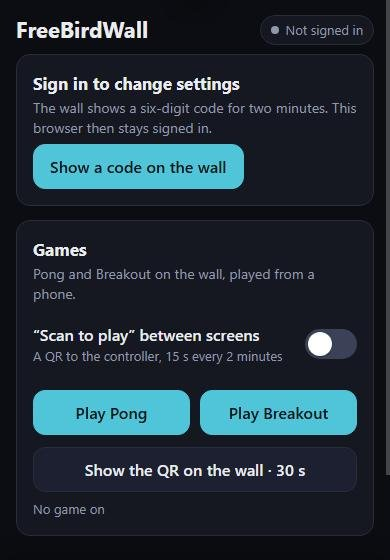 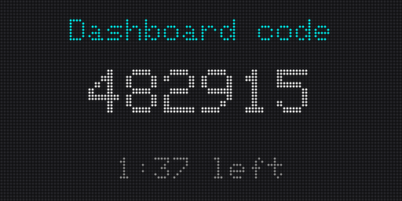

**Tip:** bookmark the dashboard, or add it to your home screen.

---

## Using the dashboard

| | |
|---|---|
| 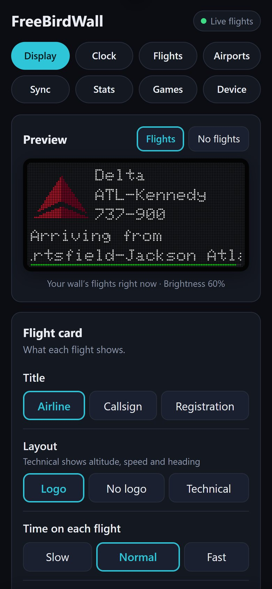 | **Display:** a live preview of the wall, what each flight shows, brightness and sleep hours, and how fast long names scroll. **Clock:** time zones, 12 or 24 hours, and up to two extra cities. **Airports:** rename airports the way you say them ("Kennedy" instead of "John F Kennedy Intl"). |
| 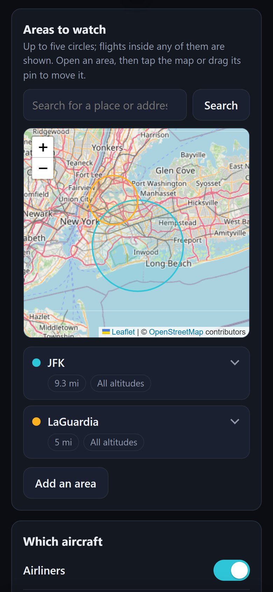 | **Flights:** where flight data comes from (the FlightWall service or the free community services), the areas the wall watches (on a map), which aircraft to show, and **tracked flights**: flights followed wherever they are. |
| 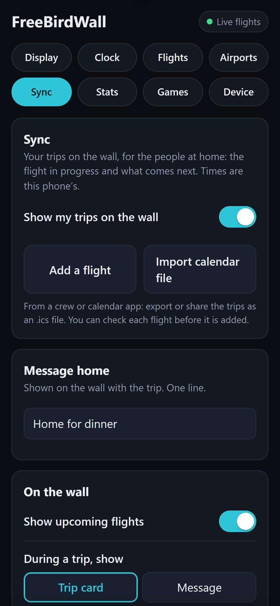 | **Sync:** your own trips. Add a flight, or import a calendar (`.ics`) file from a crew or calendar app. The wall counts down to departure, follows the plane in the air, shows what is next, and can show a message for home. |
| 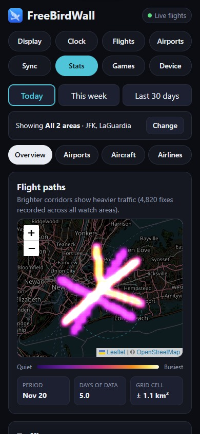 | **Stats:** flight-path heat map across your watch areas, Today / This week / Last 30 days views, top airports, aircraft types, airlines, rare aircraft badges, live worldwide airspace explorer, and [optional backup](#back-up-your-stats-optional). **Games:** see [below](#play-games-on-the-wall). **Device:** whether the wall follows changes you make in the FlightWall app, and its recent status messages. |

**See it before you save it.** Display, Clock and Airports open with a live picture of the wall, drawn by the wall's own
code: change the layout, the title, the units or an airport's name and the picture changes at once, with your wall's
flights (or sample ones when none are nearby).

**Progress bars.** Turn on **Progress bar** under Display and each flight shows how far it is between its airports, like
tracked flights do.

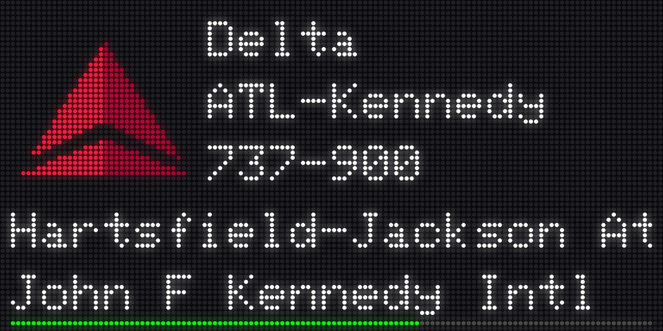

**Areas on a map.** Your areas show as circles on a map. Search for a place or tap the map to put an area there, drag its
pin to move it, and set its size with the slider. No more typing coordinates (you still can, under **Coordinates**).

Changes collect in a bar at the bottom; press **Save** and they reach the wall within a second.

**The FlightWall app still works.** Settings you change in the app reach the wall too, one setting at a time, so anything you
changed only in the dashboard stays. You can turn this off under **Device**.

---

## Weather and your flight card

### Weather when the sky is quiet

Under **Display › When the sky is quiet**, choose **Weather**. The wall then shows live airport weather whenever no
flights are nearby, in one of three layouts:

| Simple | Summary | Raw METAR |
| :---: | :---: | :---: |
| 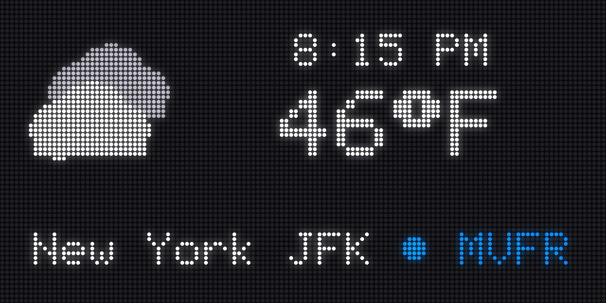 | 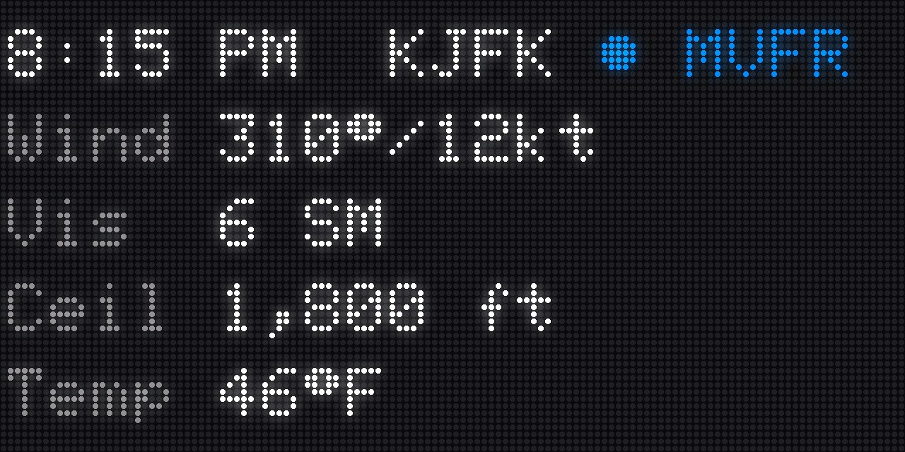 | 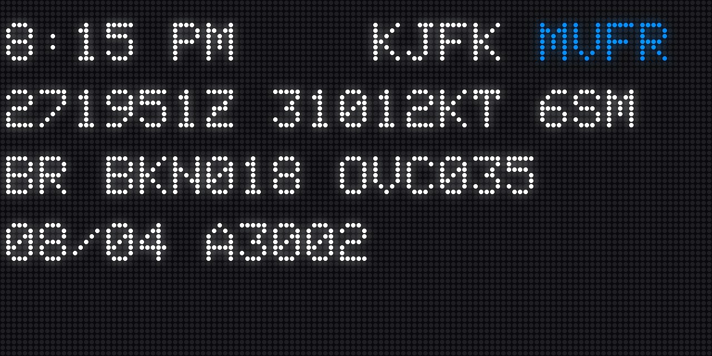 |
| A big temperature and a picture of the sky | Wind, visibility, ceiling and temperature | The report as pilots read it, a page every 4 seconds |

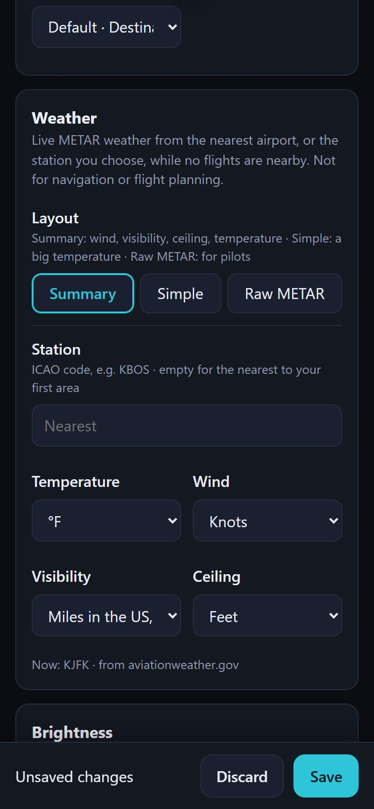

- **Station.** The wall finds the reporting airport nearest your first area. To use another, type its ICAO code
  (for example `KBOS`).
- **Units.** Temperature in °C or °F, wind in knots, mph, km/h or m/s, visibility in miles or kilometres, ceiling in
  feet or metres.
- **The flight category** (VFR, MVFR, IFR, LIFR) shows in its usual colour. A report older than 90 minutes shows its age.
- **Between flights.** Turn on **Weather between flights** (and **Clock between flights**) and they take a turn
  after each pass through the flights, at least every 20 seconds, so a busy sky still shows them.
- **Where it comes from.** The FlightWall service sends the weather when you use it. On the free flight data, the wall
  reads it from [aviationweather.gov](https://aviationweather.gov) every 10 minutes. Not for navigation or flight planning.

### Choose what each line shows

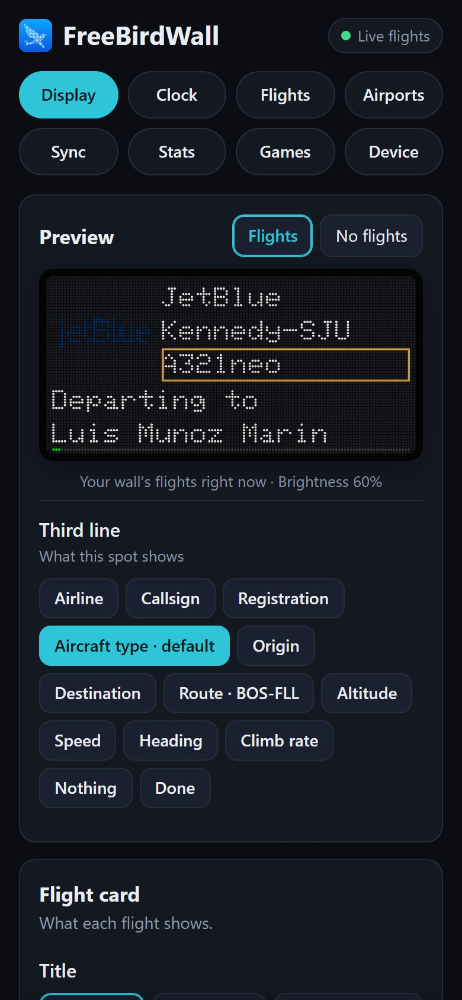 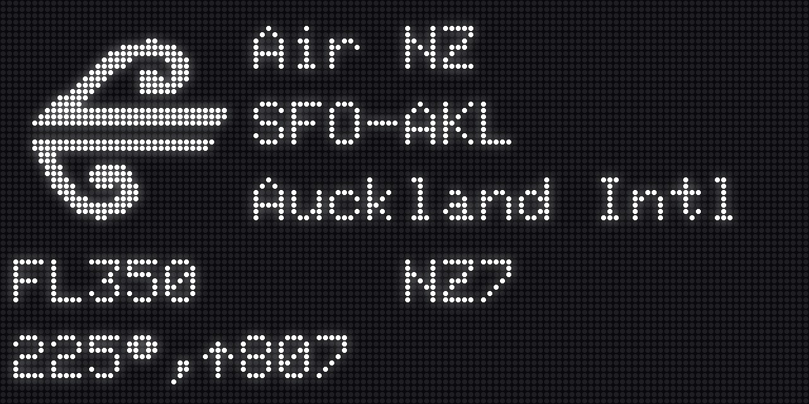

Tap a line on the live preview and pick what goes there: airline, callsign, registration, aircraft type, origin,
destination, route, altitude, speed, heading, climb rate, or nothing. The preview changes at once. The same choices are
under **Customize lines**, for each of the three layouts (**Logo**, **No logo** and **Technical**).

Under **Flight card** and **Units** you can also show the **flight number** instead of the callsign (`NZ7`, not
`ANZ7`, when the flight data has one), altitudes as **flight levels** (`FL350`), shorter number styles, the heading as
a compass point or in degrees, and keep each flight up for as long as 30 seconds.

---

## Analytics & Stats

Open the **Stats** tab to see everything your wall has watched — completely free, computed right on the wall with no cloud account or subscription.

| Flight-path heat map | Traffic & rare aircraft | Top airports, aircraft & airlines |
| :---: | :---: | :---: |
|  | 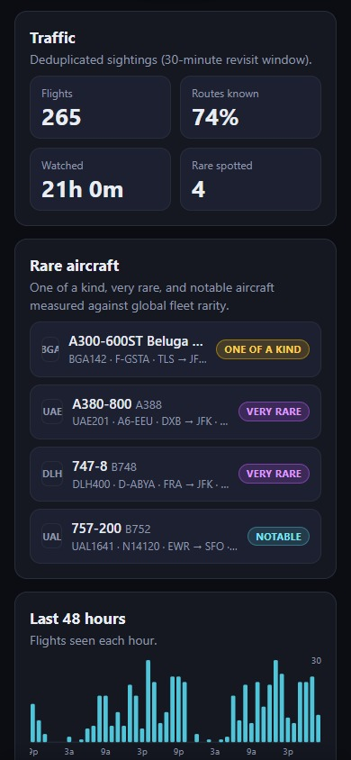 | 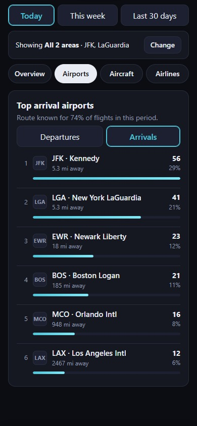 |

- **Flight-path heat map.** Every live aircraft position paints glowing corridors across all of your watch areas on a dark map (switch between **All areas** or zoom into any individual area).
- **Today, This week, and Last 30 days.** Switch timeframes with one tap across **Overview**, **Airports** (departures & arrivals), **Aircraft** (most common types), and **Airlines**.
- **Rare aircraft badges.** Automatically spots **One of a kind**, **Very rare**, and **Notable** aircraft against a built-in global fleet rarity table.
- **Explore anywhere in the world.** Tap **Change** on the area bar to search any city or airport worldwide and watch live traffic and flight trails anywhere on Earth. **Add to wall** makes the place one of your watch areas.
- **Change your areas without leaving Stats.** The same **Change** button switches between your areas and resizes them.
- **Compared with before.** Today shows how busy it is against yesterday, and This week against the week before. The comparison only appears when the wall has watched long enough in both periods for it to be fair.
- **Share cards.** Every card has a **Share** button that makes a picture to send or save. The pictures never print your area's name or a map of it: the heat map is drawn on a plain grid.

| Explore anywhere | Share cards |
| :---: | :---: |
| 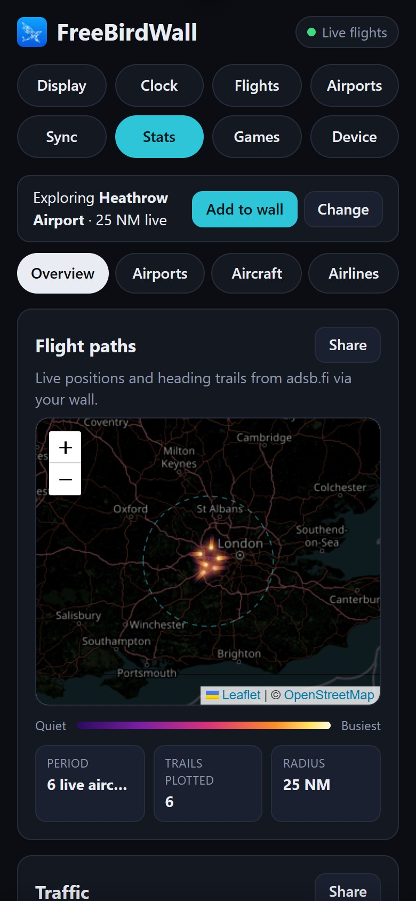 | 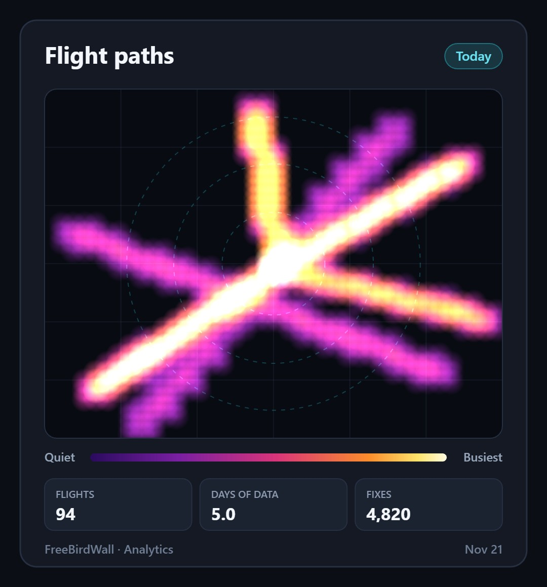<br>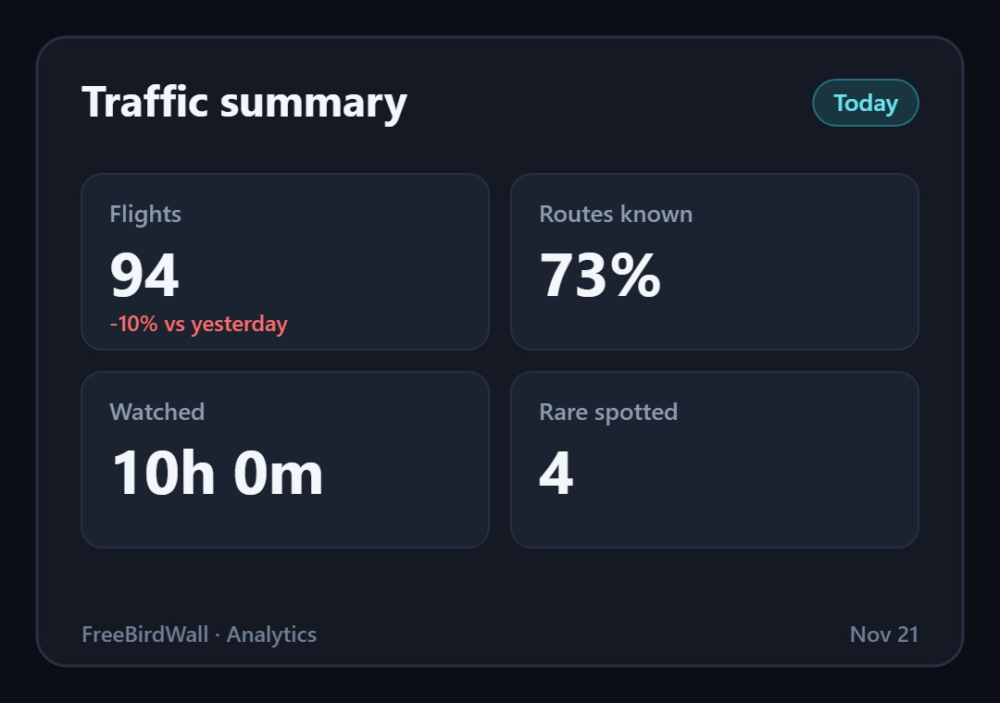 |

---

## Play games on the wall

<a href="https://mrsco.github.io/freebirdwall/videos/freebirdwall-demo.mp4">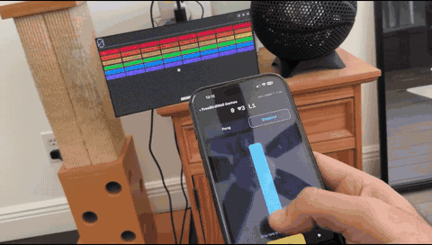</a>

*[Watch the full demo (38 s)](https://mrsco.github.io/freebirdwall/videos/freebirdwall-demo.mp4): a flight, then Breakout and Pong.*

The wall is also a little arcade. Your phone is the controller: drag up and down for Pong, left and right for Breakout.

- **Pong.** Two phones play each other, or one phone plays the computer (it can be beaten). First to 11 wins.
- **Breakout.** Arcade rules: three lives, a ball that speeds up, a paddle that shrinks once you reach the top, and a new,
  faster wall each time you clear one.

**To play,** press **Play Pong** or **Play Breakout** in the dashboard. For guests, press **Show the QR on the wall**, or
turn on **"Scan to play" between screens**: anyone on your Wi-Fi can scan the code and join, no sign-in needed. The game
page reaches only the game, never your settings. Add it to your home screen to play again with a single tap.

Phones that can vibrate buzz when the score changes. When nobody has played for a minute, the wall goes back to showing
flights.

---

## Back up your stats (optional)

To keep your wall's flash memory from wearing out, your stats and heat map live in RAM while the wall runs. If you want your 30-day history and heat map to survive power outages, reboots, and firmware updates, pick either option:

| Option | How it works | Best for |
|---|---|---|
| **Manual download** | Open **Stats → Persistence & backup** and tap **Download backup** / **Restore backup** (`.fwan` file). | Quick occasional backups — no setup required. |
| **Automatic LAN / NAS backup** | Run the tiny zero-dependency [`desk/stats_server.py`](desk/stats_server.py) script on a PC, Raspberry Pi, or NAS on your Wi-Fi. The wall auto-saves every 15 minutes and restores automatically on reboot. | Hands-off persistence across reboots & updates. |

> [!NOTE]
> **Why an HTTP server instead of a `\\NAS\share` folder path?** The wall's ESP32-S3 has only ~35 KiB of free RAM, which isn't enough for a Windows SMB file-sharing client. Plain HTTP (`GET`/`PUT /checkpoint`) uses almost no RAM, and [`desk/stats_server.py`](desk/stats_server.py) uses only Python 3's standard library (zero packages to install).

<details>
<summary><strong>Windows PC / Windows NAS setup (auto-starts invisibly on boot)</strong></summary>

1. Copy [`desk/stats_server.py`](desk/stats_server.py) onto your Windows PC or NAS (for example `C:\FreeBirdWall\stats_server.py`). Install Python 3 if needed (`winget install Python.Python.3.12`).
2. Test it in PowerShell, pointing `--dir` at any local or shared folder:
   ```powershell
   py C:\FreeBirdWall\stats_server.py --port 8090 --dir "D:\YourShare\freebirdwall-stats"
   ```
   *(If you run it on another always-on Windows PC, `--dir` can also point directly at a network UNC share like `"\\NAS\share\freebirdwall-stats"`.)*
3. Allow port `8090` on your private network (run once in an **Admin PowerShell**):
   ```powershell
   New-NetFirewallRule -DisplayName "FreeBirdWall Stats Backup" -Direction Inbound -Protocol TCP -LocalPort 8090 -Profile Private -Action Allow
   ```
4. Auto-start invisibly when Windows boots (run once in an **Admin PowerShell** — runs in the background with no terminal window, even before anyone logs in):
   ```powershell
   $pyw = (Get-Command pythonw.exe).Source
   $action = New-ScheduledTaskAction -Execute $pyw -Argument 'C:\FreeBirdWall\stats_server.py --port 8090 --dir "D:\YourShare\freebirdwall-stats"'
   $trigger = New-ScheduledTaskTrigger -AtStartup
   $settings = New-ScheduledTaskSettingsSet -AllowStartIfOnBatteries -DontStopIfGoingOnBatteries -RestartCount 3 -RestartInterval (New-TimeSpan -Minutes 1) -ExecutionTimeLimit ([TimeSpan]::Zero)
   Register-ScheduledTask -TaskName "FreeBirdWallStatsBackup" -Action $action -Trigger $trigger -Settings $settings -User "SYSTEM" -RunLevel Highest -Force
   Start-ScheduledTask -TaskName "FreeBirdWallStatsBackup"
   ```

</details>

<details>
<summary><strong>Docker setup (Synology, Unraid, TrueNAS, QNAP, Linux)</strong></summary>

Copy [`desk/stats_server.py`](desk/stats_server.py) into a folder on your NAS (e.g. `/path/on/nas/freebirdwall`) and run:

```bash
docker run -d --name freebirdwall-stats --restart unless-stopped \
  -p 8090:8090 \
  -v /path/on/nas/freebirdwall:/data \
  python:3-alpine \
  python /data/stats_server.py --port 8090 --dir /data
```

</details>

<details>
<summary><strong>Linux / Mac / Raspberry Pi setup (Python 3 directly)</strong></summary>

```bash
python3 desk/stats_server.py --port 8090 --dir ./freebirdwall-stats
```

</details>

**Connect your wall (3 steps):**
1. Open `http://<server-ip>:8090/health` in a browser — you should see `{"ok": true, ...}`.
2. In the wall dashboard, go to **Stats → Persistence & backup**, enter `http://<server-ip>:8090`, and press **Save**.
3. Press **Back up now** and confirm `checkpoint.fwan` appears in your backup folder.

---

## Updates

Plug in the USB cable and open the installer again; it always has the newest version. It sees that the wall already runs
FreeBirdWall, keeps your settings and sign-ins, and updates it. The original firmware stays on the wall through every update.

Installed with an installer from before October 28, 2026? Those replaced the original firmware with the first update. The
installer tells you when that has happened; your backup brings it back (below).

## Going back

Plug in the USB cable, open the installer and click **Connect**. Under **Go back** you can:

- **Start the vendor firmware again.** The original firmware stays on the wall after an install and after updates, so this
  only changes which one starts. Your dashboard settings stay on the wall in case you come back.
- **Restore a backup.** Puts your backup file back, so the wall is exactly as it was when you saved it. Keep the backup from your
  first install: it is the one copy of your wall as it came.

---

## If something goes wrong

**The browser does not list the wall.** Use a different USB-C cable (many only charge), and plug it straight into the
computer, not through a hub. Use Chrome or Edge on a computer; phones and Safari or Firefox cannot do this. On Windows, no
driver is needed.

**Connect fails.** Unplug the USB cable and plug it back in, then try again. If it still fails, hold the **BOOT** button (S1,
see the photo above) while you plug the cable in, then try again.

**The board check fails.** Stop here. The installer has not changed anything, and the wall keeps working as before. Your wall
has different hardware from the one this firmware was written for (the maker can change parts between batches), and installing
it anyway could harm it. Please open an issue with a photo of the check list.

**The wall is dark or keeps restarting after the install.** If the firmware crashes three times in a row, it starts in a safe
mode with only Wi-Fi. Plug in USB, open the installer, and use **Start the vendor firmware again** or **Restore a backup**.

**I cannot find the dashboard address.**
- The QR code shows for one minute after the wall joins Wi-Fi, while no browser is signed in. Unplug the wall's power for a few
  seconds to see it again.
- Your router's list of connected devices also shows the wall.
- Phones on a *guest* Wi-Fi network usually cannot reach devices on the main network.

---

## Good to know

- **Not official.** FreeBirdWall is not made by or connected with the makers of FlightWall. FlightWall is their name; it is
  used here only to say which hardware this runs on.
- **Your data stays home.** The dashboard runs on the wall itself, on your Wi-Fi. Sign-in codes, keys and your home location are
  never written to its logs. The areas map is the one exception to "nothing leaves your network": your phone loads the map
  and place search from OpenStreetMap, so OpenStreetMap sees the part of the map you look at. The wall itself never
  contacts it.
- **Gentle on the wall.** Settings are saved only when you change something, so the flash memory wears no faster than with the
  original firmware. Tracked flights and trips are looked up about once a minute, not every few seconds.
- **The board check** confirms the chip (ESP32-S3), 8 MB of flash, that the flash and memory chips leave the display's pins
  free, that flash encryption and secure boot are off, that the memory layout is the FlightWall mini's, and that the wall runs
  the vendor firmware or FreeBirdWall. The firmware repeats the same check every time it starts, and leaves the display off if any of it
  fails.

## For developers

| | |
|---|---|
| `runtime/firmware/` | The firmware (ESP-IDF 4.4.7). Start with its [README](runtime/firmware/README.md); design notes are in `FEED.md`, `SETTINGS.md`, `SYNC.md`, `UPDATES.md` and the other documents there. |
| `installer/` | The USB installer. `py installer/tools/build_installer.py` builds `dist/freebirdwall-installer.html` from the keepable build and `publish_site.py` puts it on the website (`docs/install/`, served by GitHub Pages; `docs/index.html` is the hand-written home page); `node installer/tests/test_installer.mjs` runs its tests; add `#demo` to the page's address to try it on a pretend wall. |
| `desk/` | Desk tools for your own wall over Wi-Fi: status, the log, updates and the vendor firmware back into the spare slot (`py desk/firmware_cli.py status\|log\|update\|spare`), with your wall's address and key in `desk/device.json` (never committed), plus the optional LAN/NAS analytics backup server (`desk/stats_server.py`). Tests: `py -m unittest discover desk`. |
| `shared/` | Code the firmware and the desk share: the update checker, SHA-256, airport names and the pinned TLS roots. |
| `runtime/net/`, `runtime/src/` | The source-built HTTPS client and the community-feed reader, with their own tests. |

FreeBirdWall is MIT-licensed (`LICENSE`); third-party code keeps its own licence (`THIRD-PARTY-NOTICES.md`). It
started as a reverse-engineering study of the vendor firmware, so the design notes cite where stock behaviour was
found (the `FUN_…` addresses refer to the vendor's application image). No vendor code or images are included; four
small data tables were read out of the vendor firmware so the wall looks the same: the extra text glyphs
(`fw_text/vendor_charmap.c`), the clock's date glyphs (`fw_clock/clock_tables.c`), the screen layouts
(`vendor-layouts.json`) and the aircraft types' silhouette families (`fw_logo/aircraft_families.c`). The vendor's
logos, icons and pictures are never in this repository: the wall downloads them from the maker's own update server
and checks the maker's signature.
