# FreeBirdWall

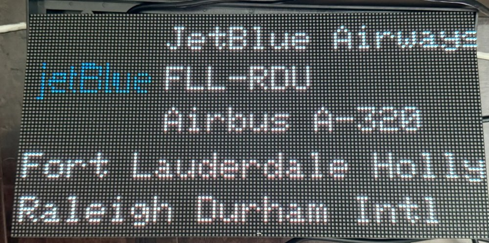

**FreeBirdWall** is free firmware for the **FlightWall mini**, the LED panel that shows the planes flying over your home. It
keeps everything the wall already does, needs no subscription, and adds:

- **A dashboard on your phone.** Change every setting from any phone or computer on your Wi-Fi, with a **live preview** of
  the wall as you go, and the areas it watches **on a map**.
- **Progress bars.** Each flight can show how far it is between its airports, along the bottom of the wall.
- **Games on the wall.** Play [Pong and Breakout](#play-games-on-the-wall) on the LEDs, with your phone as the controller. Two phones can play Pong against each other.
- **Free flight data.** Choose the community services ([adsb.fi](https://adsb.fi) and [adsbdb](https://www.adsbdb.com)) instead of the FlightWall service if you like.
- **Your trips on the wall (Sync).** Add your flights or import a calendar file, and the wall shows the trip and follows the plane while it is in the air.
- **Tracked flights**, with real times when you add a FlightAware key.
- **Stats** of the planes your wall has seen, **extra clocks**, and **your own airport names**.
- **Names that fit.** Long airline and airport names are shortened, and scroll if they are still too long.

You can go back to the original firmware at any time: it stays on the wall, next to FreeBirdWall.

---

## What you need

- A FlightWall mini **already set up with the FlightWall app** (so it knows your Wi-Fi).
- A computer with **Google Chrome** or **Microsoft Edge** (Windows, Mac, Linux or ChromeOS).
- A **USB-C data cable**. Some cables only charge; if the computer cannot see the wall, try another cable.
- A small screwdriver to open the back of the wall.
- About 15 minutes.

## Install it

### 1. Open the installer

Open **[https://mrsco.github.io/freebirdwall/](https://mrsco.github.io/freebirdwall/)** in Chrome or Edge on a computer. Nothing needs
installing, and nothing is sent anywhere: the installer runs in the page and talks to the wall over the USB cable.
(Offline? Save that page, or `freebirdwall-installer.html` from the Releases page, and open the file instead.)

### 2. Plug the wall into your computer

Leave the wall plugged into power. Open the back cover: the small blue controller board sits where the ribbon cable starts.
Plug the USB-C cable into its USB-C port, then into your computer.

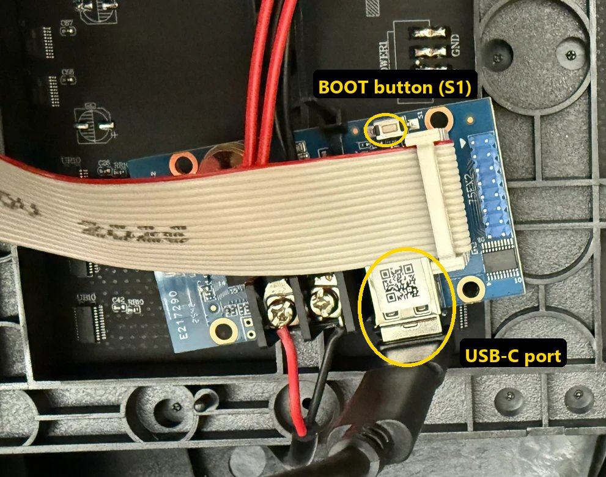

### 3. Run the installer

Follow the installer's steps.

1. **Connect.** Click **Connect** and choose the wall in the list. On Windows it is called *USB Serial Device (COM…)*;
   elsewhere it may be *USB JTAG/serial debug unit*. The panel goes dark while the installer works; that is normal.
2. **Check the board.** The installer reads the chip, its memory and its settings, and only continues if this is exactly the
   board this firmware was made for. If anything is different it stops before changing anything, so the firmware can never land
   on hardware it could damage.

   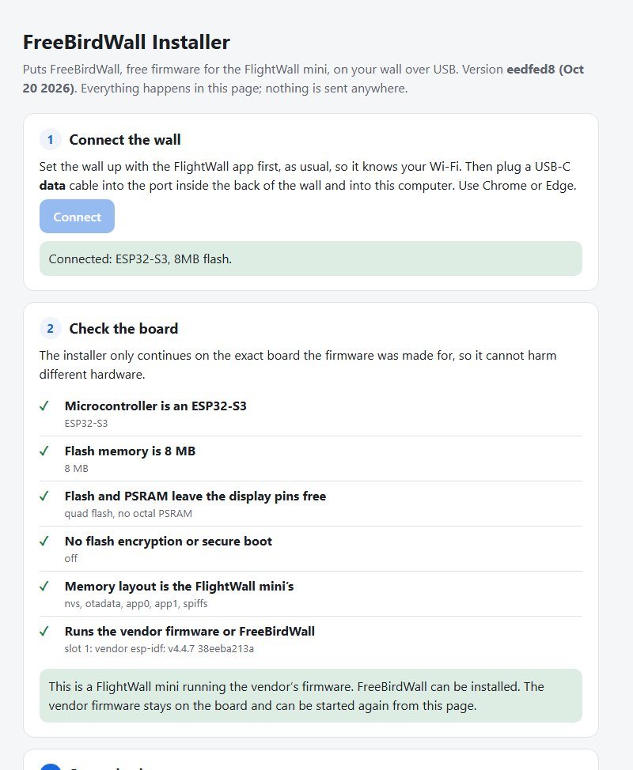

3. **Save a backup.** A complete copy of the wall (8 MB) is saved on your computer and checked; it takes a few minutes. Keep
   it somewhere safe. It is this wall's own copy, including its Wi-Fi password, so do not share it. When you update later and
   still have this backup, **Skip the backup** saves the wait (it asks twice).
4. **Install.** The new firmware is written *next to* the original one, read back to make sure it is right, and only then set to
   start. Your Wi-Fi and settings stay.
5. **First start.** The wall restarts with the new firmware. The installer watches it check the board, join your Wi-Fi, and
   report its address.

   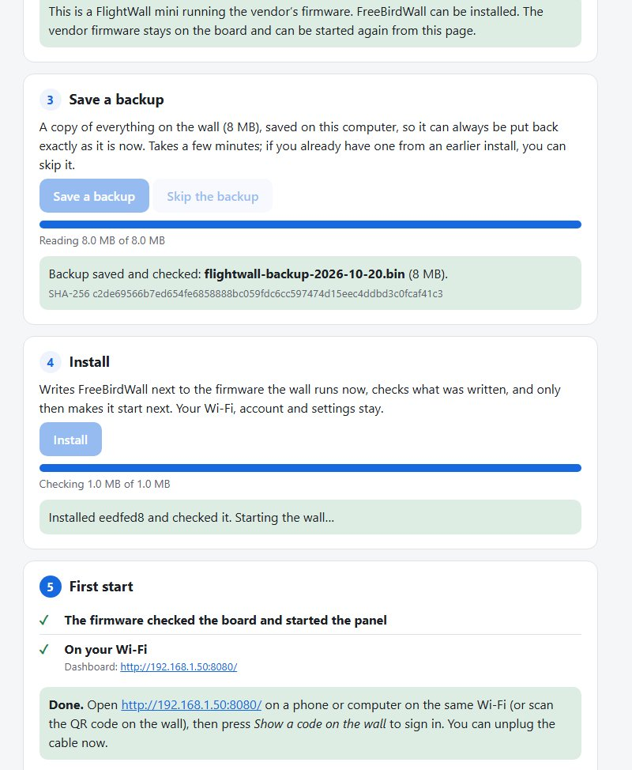

   On the wall, FreeBirdWall says hello while it joins your Wi-Fi:

   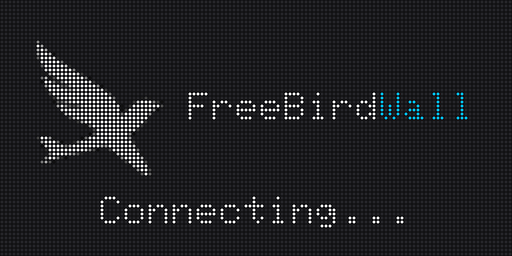

Unplug the USB cable and close the back. You will not need the cable again for everyday use.

### 4. Open your dashboard

For its first minute on Wi-Fi, the wall shows a QR code with its address. Scan it with your phone's camera, or type the
address into a browser on the same Wi-Fi.

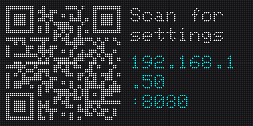

Press **Show a code on the wall**, then type the six digits the wall shows. That phone or computer stays signed in. You can
sign in up to four browsers this way.

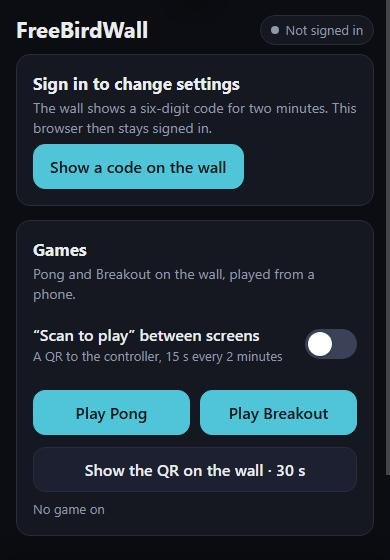 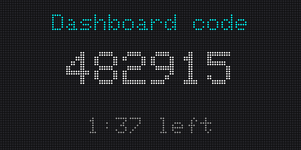

**Tip:** bookmark the dashboard, or add it to your home screen.

---

## Using the dashboard

| | |
|---|---|
| 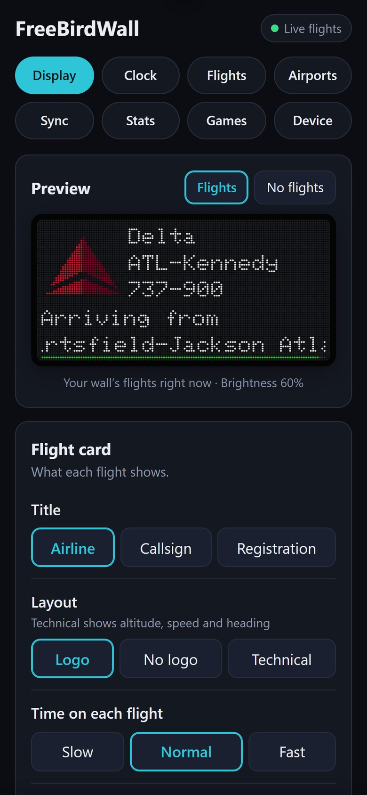 | **Display:** a live preview of the wall, what each flight shows, brightness and sleep hours, and how fast long names scroll. **Clock:** time zones, 12 or 24 hours, and up to two extra cities. **Airports:** rename airports the way you say them ("Kennedy" instead of "John F Kennedy Intl"). |
| 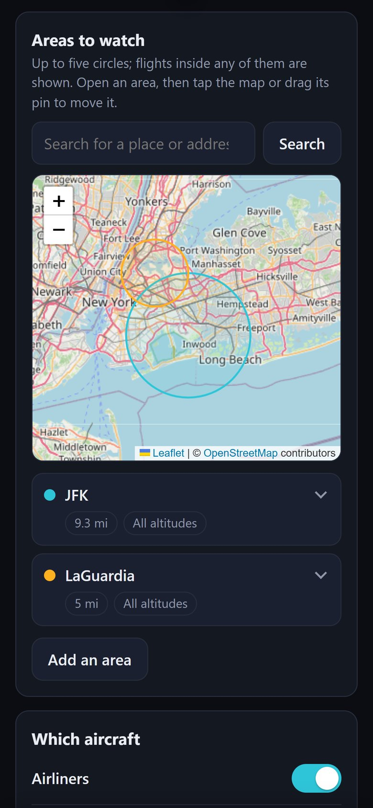 | **Flights:** where flight data comes from (the FlightWall service or the free community services), the areas the wall watches (on a map), which aircraft to show, and **tracked flights**: flights followed wherever they are. |
| 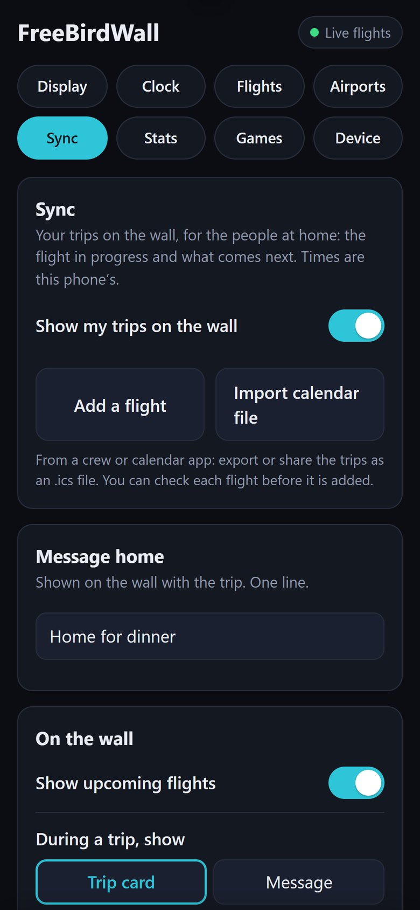 | **Sync:** your own trips. Add a flight, or import a calendar (`.ics`) file from a crew or calendar app. The wall counts down to departure, follows the plane in the air, shows what is next, and can show a message for home. |
| 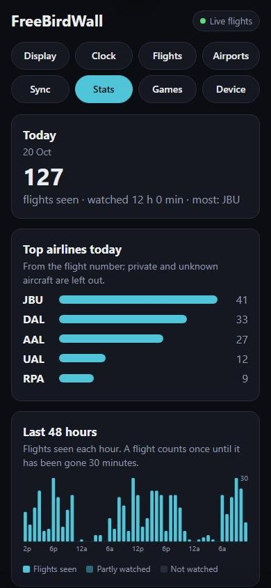 | **Stats:** flights seen today, the top airlines, the last 48 hours and the last 31 days. **Games:** see [below](#play-games-on-the-wall). **Device:** whether the wall follows changes you make in the FlightWall app, and its recent status messages. |

**See it before you save it.** Display, Clock and Airports open with a live picture of the wall, drawn by the wall's own
code: change the layout, the title, the units or an airport's name and the picture changes at once, with your wall's
flights (or sample ones when none are nearby).

**Progress bars.** Turn on **Progress bar** under Display and each flight shows how far it is between its airports, like
tracked flights do.

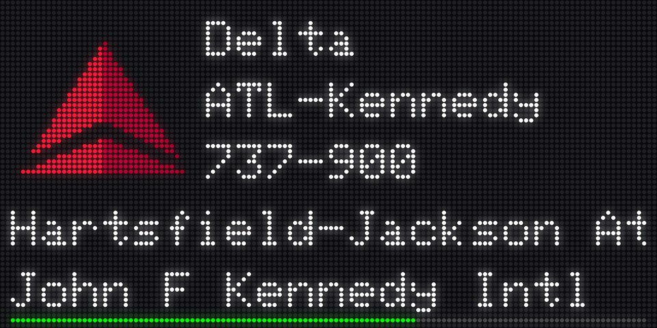

**Areas on a map.** Your areas show as circles on a map. Search for a place or tap the map to put an area there, drag its
pin to move it, and set its size with the slider. No more typing coordinates (you still can, under **Coordinates**).

Changes collect in a bar at the bottom; press **Save** and they reach the wall within a second.

**The FlightWall app still works.** Settings you change in the app reach the wall too, one setting at a time, so anything you
changed only in the dashboard stays. You can turn this off under **Device**.

---

## Play games on the wall

<a href="https://mrsco.github.io/freebirdwall/videos/freebirdwall-demo.mp4">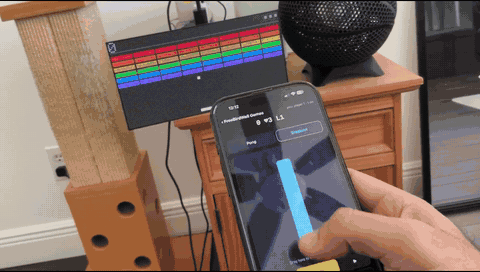</a>

*[Watch the full demo (38 s)](https://mrsco.github.io/freebirdwall/videos/freebirdwall-demo.mp4): a flight, then Breakout and Pong.*

The wall is also a little arcade. Your phone is the controller: drag up and down for Pong, left and right for Breakout.

- **Pong.** Two phones play each other, or one phone plays the computer (it can be beaten). First to 11 wins.
- **Breakout.** Arcade rules: three lives, a ball that speeds up, a paddle that shrinks once you reach the top, and a new,
  faster wall each time you clear one.

**To play,** press **Play Pong** or **Play Breakout** in the dashboard. For guests, press **Show the QR on the wall**, or
turn on **"Scan to play" between screens**: anyone on your Wi-Fi can scan the code and join, no sign-in needed. The game
page reaches only the game, never your settings. Add it to your home screen to play again with a single tap.

Phones that can vibrate buzz when the score changes. When nobody has played for a minute, the wall goes back to showing
flights.

---

## Updates

Plug in the USB cable and open the installer again; it always has the newest version. It sees that the wall already runs
FreeBirdWall, keeps your settings and sign-ins, and updates it. The original firmware stays on the wall through every update.

Installed with an installer from before October 28, 2026? Those replaced the original firmware with the first update. The
installer tells you when that has happened; your backup brings it back (below).

## Going back

Plug in the USB cable, open the installer and click **Connect**. Under **Go back** you can:

- **Start the vendor firmware again.** The original firmware stays on the wall after an install and after updates, so this
  only changes which one starts. Your dashboard settings stay on the wall in case you come back.
- **Restore a backup.** Puts your backup file back, so the wall is exactly as it was when you saved it. Keep the backup from your
  first install: it is the one copy of your wall as it came.

---

## If something goes wrong

**The browser does not list the wall.** Use a different USB-C cable (many only charge), and plug it straight into the
computer, not through a hub. Use Chrome or Edge on a computer; phones and Safari or Firefox cannot do this. On Windows, no
driver is needed.

**Connect fails.** Unplug the USB cable and plug it back in, then try again. If it still fails, hold the **BOOT** button (S1,
see the photo above) while you plug the cable in, then try again.

**The board check fails.** Stop here. The installer has not changed anything, and the wall keeps working as before. Your wall
has different hardware from the one this firmware was written for (the maker can change parts between batches), and installing
it anyway could harm it. Please open an issue with a photo of the check list.

**The wall is dark or keeps restarting after the install.** If the firmware crashes three times in a row, it starts in a safe
mode with only Wi-Fi. Plug in USB, open the installer, and use **Start the vendor firmware again** or **Restore a backup**.

**I cannot find the dashboard address.**
- The QR code shows for one minute after the wall joins Wi-Fi, while no browser is signed in. Unplug the wall's power for a few
  seconds to see it again.
- Your router's list of connected devices also shows the wall.
- Phones on a *guest* Wi-Fi network usually cannot reach devices on the main network.

---

## Good to know

- **Not official.** FreeBirdWall is not made by or connected with the makers of FlightWall. FlightWall is their name; it is
  used here only to say which hardware this runs on.
- **Your data stays home.** The dashboard runs on the wall itself, on your Wi-Fi. Sign-in codes, keys and your home location are
  never written to its logs. The areas map is the one exception to "nothing leaves your network": your phone loads the map
  and place search from OpenStreetMap, so OpenStreetMap sees the part of the map you look at. The wall itself never
  contacts it.
- **Gentle on the wall.** Settings are saved only when you change something, so the flash memory wears no faster than with the
  original firmware. Tracked flights and trips are looked up about once a minute, not every few seconds.
- **The board check** confirms the chip (ESP32-S3), 8 MB of flash, that the flash and memory chips leave the display's pins
  free, that flash encryption and secure boot are off, that the memory layout is the FlightWall mini's, and that the wall runs
  the vendor firmware or FreeBirdWall. The firmware repeats the same check every time it starts, and leaves the display off if any of it
  fails.

## For developers

| | |
|---|---|
| `runtime/firmware/` | The firmware (ESP-IDF 4.4.7). Start with its [README](runtime/firmware/README.md); design notes are in `FEED.md`, `SETTINGS.md`, `SYNC.md`, `UPDATES.md` and the other documents there. |
| `installer/` | The USB installer. `py installer/tools/build_installer.py` builds `dist/freebirdwall-installer.html` from the keepable build and `publish_site.py` puts it on the website (`docs/`, served by GitHub Pages); `node installer/tests/test_installer.mjs` runs its tests; add `#demo` to the page's address to try it on a pretend wall. |
| `desk/` | Desk tools for your own wall over Wi-Fi: status, the log, updates and the vendor firmware back into the spare slot (`py desk/firmware_cli.py status\|log\|update\|spare`), with your wall's address and key in `desk/device.json` (never committed). Tests: `py -m unittest discover desk`. |
| `shared/` | Code the firmware and the desk share: the update checker, SHA-256, airport names and the pinned TLS roots. |
| `runtime/net/`, `runtime/src/` | The source-built HTTPS client and the community-feed reader, with their own tests. |

FreeBirdWall is MIT-licensed (`LICENSE`); third-party code keeps its own licence (`THIRD-PARTY-NOTICES.md`). It
started as a reverse-engineering study of the vendor firmware, so the design notes cite where stock behaviour was
found (the `FUN_…` addresses refer to the vendor's application image). No vendor code or images are included; three
small data tables were read out of the vendor firmware so the wall looks the same: the extra text glyphs
(`fw_text/vendor_charmap.c`), the clock's date glyphs (`fw_clock/clock_tables.c`) and the screen layouts
(`vendor-layouts.json`).
